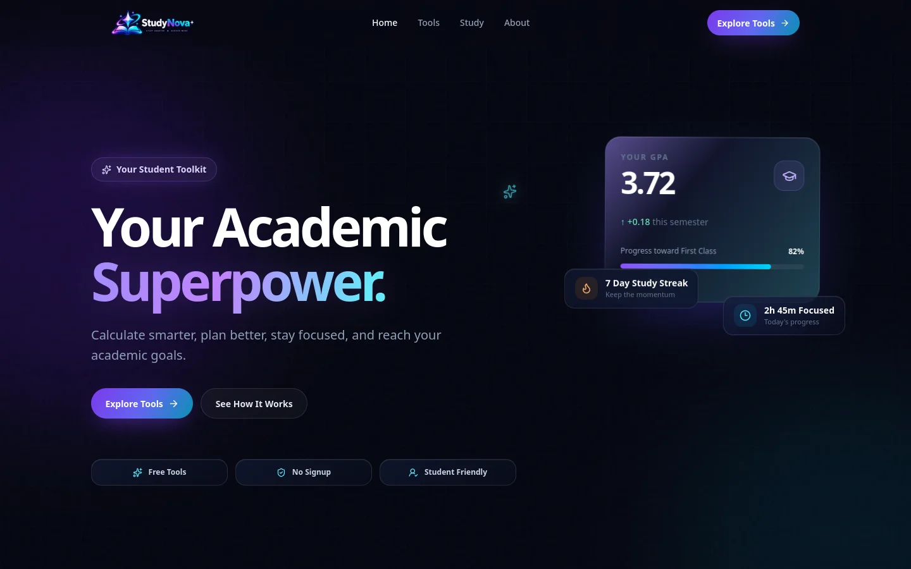
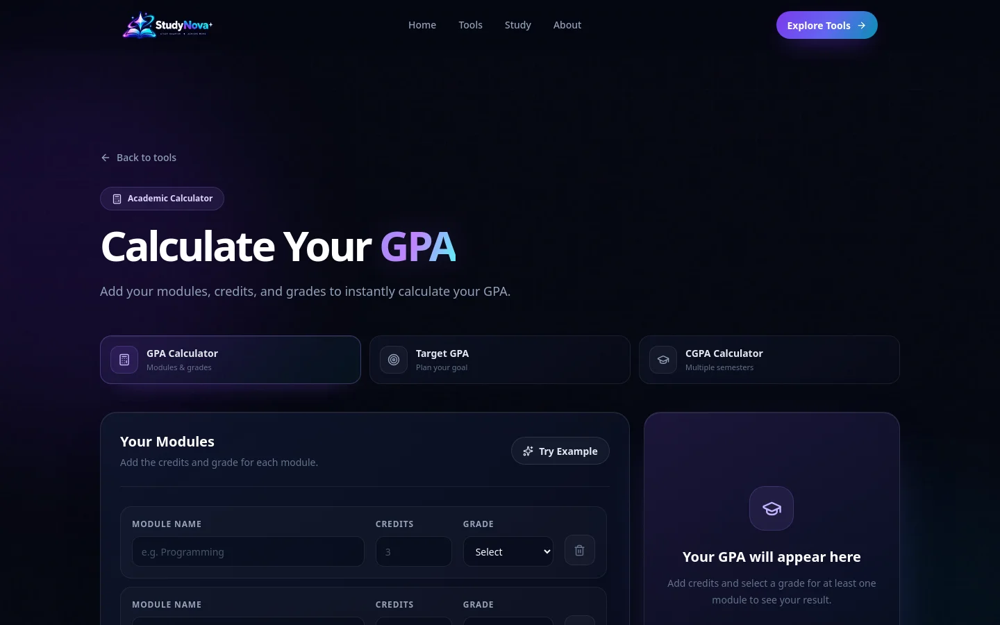
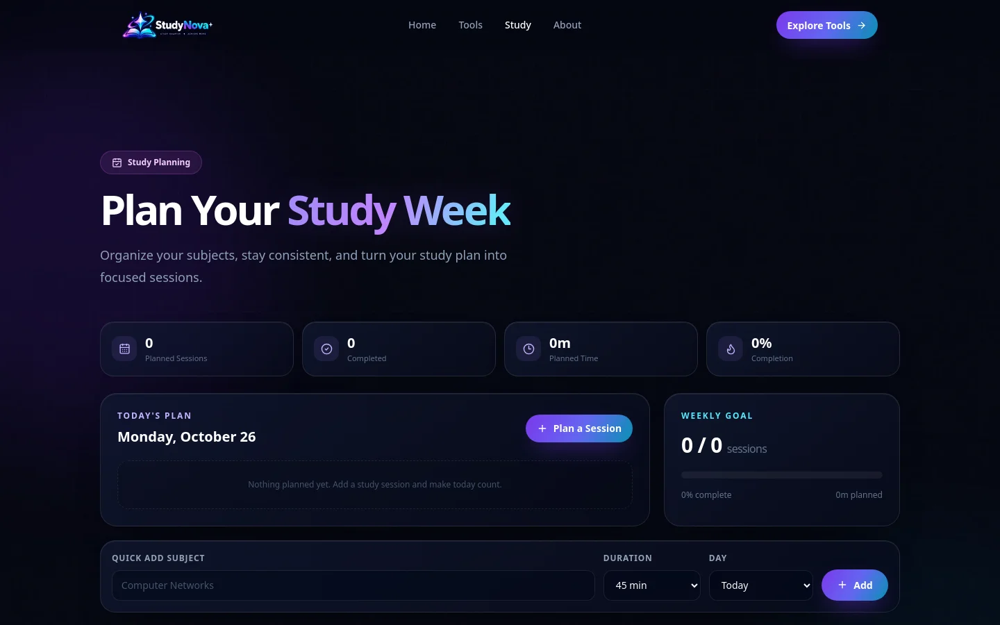
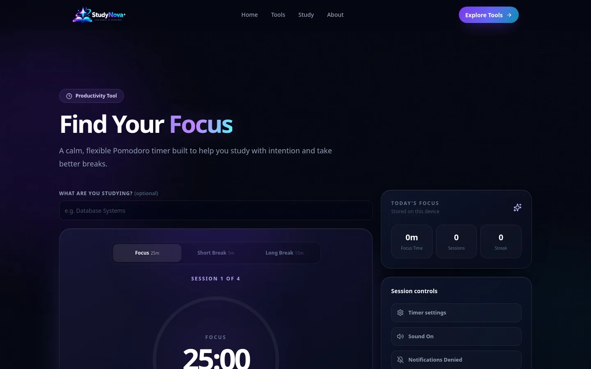

# StudyNova

Free academic and study tools for students: GPA calculators, a study planner and a focus timer. No sign-up, and your data stays in your browser.



## Tools

- **GPA Calculator:** semester GPA from module grades and credits
- **Target GPA Calculator:** the grades you need to reach a goal
- **CGPA Calculator:** cumulative GPA across semesters
- **Study Planner:** turn subjects and deadlines into a weekly plan, with daily and weekly goals
- **Focus Timer:** Pomodoro sessions with breaks, session stats and sound/notification controls

The site also has SEO metadata, a sitemap, JSON-LD and scroll animations that respect reduced-motion settings.

## Screenshots

### GPA Calculator


### Study Planner


### Focus Timer


## Tech stack

| Part | Technology |
| --- | --- |
| Framework | Next.js (App Router), React |
| Styling | Tailwind CSS |
| Icons | Lucide |

## Run it locally

```bash
cp .env.example .env.local   # optional: set your public site URL
npm install
npm run dev
```

Open <http://localhost:3000>.

```bash
npm run lint
npm run build
```
